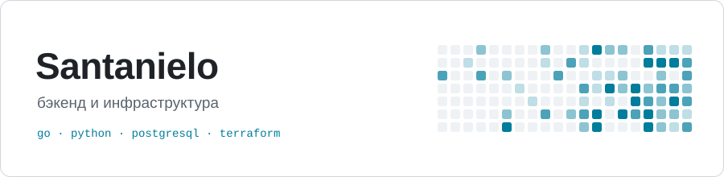

<picture>
  <source media="(prefers-color-scheme: dark)" srcset="assets/header-dark.svg">
  
</picture>

Пишу на Python, сейчас перехожу на Go. Больше всего нравятся задачи на стыке кода и инфраструктуры: деплой, облако, восстановление после сбоев.

### Проекты

**[yandex-backup-under-test](https://github.com/Santaniel0/yandex-backup-under-test)** — проверяет, что бэкап PostgreSQL в Yandex Cloud действительно восстанавливается. Поднимает копию в отдельном кластере, сверяет данные и версии файлов в Object Storage, потом убирает за собой. 
Python · Terraform · Cloud Functions · Workflows

### Документация Yandex Cloud

- [Что делать при утечке статического ключа доступа](https://github.com/yandex-cloud/docs/pull/1118) · `принят`
- [Защита резервных копий от удаления и перезаписи](https://github.com/yandex-cloud/docs/pull/1119) · `на ревью`
- [Проверка восстановления PostgreSQL и вложений Object Storage](https://github.com/yandex-cloud/docs/pull/1233) · `черновик`

### Стек

